# Installation Guide

<!-- md-trans-meta sourceCommit=f681104ec2cb652de05c639f43dd0395c9708d16 translatedAt=2026-11-19T02:43:16.691Z pushedAt=2026-11-19T06:18:46.230Z -->

## Environment Setup

### Environment Requirements

Before installation, check that the environment meets the current support scope of KACC_Crypto.

**Table 1** Hardware requirements

| Item | Description |
| --- | --- |
| Processor | Kunpeng 950 |
| Architecture | AArch64 |
| SVE vector length | AES-XTS hot path optimized for 256-bit vectors |
| Accelerator device | No external accelerator cards required |

**Table 2** OS and software requirements

| Item | Description |
| --- | --- |
| OS | AArch64 Linux |
| OpenSSL | OpenSSL 3.0.16 |
| Compiler | GCC or Clang that supports AArch64 SVE2-related `-march` options |
| Build tool | Git, GCC, make, perl, Python 3 |

>  **NOTE**
>
>- The AES-GCM and AES-XTS optimizations depend on AArch64 SVE2 capabilities. When the capability condition is not met, fall back to the original OpenSSL path.
>- The RSA benchmark uses SVE2 assembly and links the OpenSSL `libcrypto` library, supporting both `libcrypto.a` and `libcrypto.so`.
>- Combinations not on the list of verified environments require separate compatibility and performance verification.

### Installing Dependencies

- yum-based distributions

  ```bash
  sudo yum install -y git gcc make perl python3
  ```

- apt-based distributions

  ```bash
  sudo apt-get update
  sudo apt-get install -y git gcc make perl python3
  ```

## Installation Methods

KACC_Crypto currently provides a source code integration method: The repository stores the source code for the optimizations, integration scripts, and test scripts. To use the optimizations, integrate the optimized code into the target OpenSSL source tree, and then recompile OpenSSL or compile the benchmark independently.

**Table 3** Installation methods

| Installation Method | Description | Application Scenario |
| --- | --- | --- |
| Source code integration | Modify the target OpenSSL source tree through the `scripts/install_*` script and copy the optimized source code. | Functional verification, performance verification, and subsequent upstream development |
| One-click verification | Complete integration and testing through the `scripts/apply_and_test_*` script. | Quick regression of a single algorithm |

## Preparing the OpenSSL Source Tree

The following screenshots are rendered from actual command output collected in an openEuler 24.03 LTS SP3 environment with GCC 12.3.1. The test results have not been rewritten, and user names and user directories are replaced with `***`. The verification directories in the screenshots are examples only; you do not need to use the same directory names. The example compilation concurrency is 16 and can be adjusted based on machine resources.

1. Obtain the OpenSSL source code.

    ```bash
    git clone --depth 1 -b openssl-3.0.16 https://github.com/openssl/openssl.git openssl
    cd openssl
    ```

2. Configure and compile OpenSSL.

    ```bash
    ./Configure linux-aarch64
    make -j16 > build-native.log 2>&1
    echo "OpenSSL build exit status: $?"
    tail -n 4 build-native.log
    ```

    Confirm that the build exit status is `0`, and then check the generated artifacts and the running version.

    ```bash
    test -f include/openssl/configuration.h
    test -f libcrypto.a || test -f libcrypto.so || test -f .openssl/lib/libcrypto.so
    echo $?
    LD_LIBRARY_PATH="$PWD" ./apps/openssl version
    ```

    The exit status should be `0`, and the version should be `OpenSSL 3.0.16`. The libraries and executables generated here are within the source tree; the subsequent `OPENSSL_DIR` points to this source tree, not the directory where the system `/usr/bin/openssl` resides.

    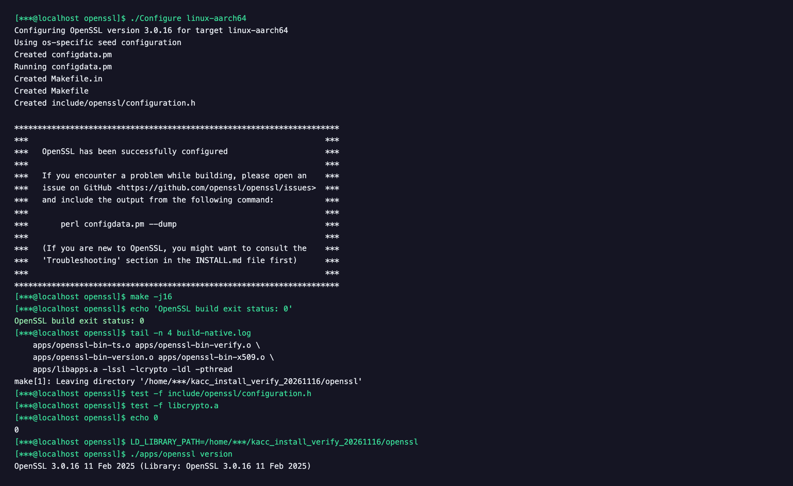

## Obtaining KACC_Crypto Code

```bash
git clone --depth 1 -b dev https://gitcode.com/boostkit/kacc_crypto.git kacc_crypto
cd kacc_crypto
export OPENSSL_DIR=/path/to/openssl
```

`/path/to/openssl` is the path to an OpenSSL source tree that has been configured and compiled. Replace it with the actual path in subsequent commands.

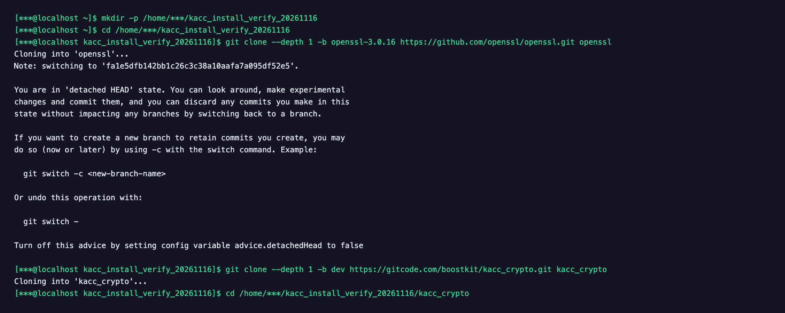

## Software Package Integrity Verification

This project currently provides source code through a Git repository, obtained via `git clone`, and does not provide a standalone software package, digital signature file, or SHA-256 checksum file. After obtaining the source code, you can check the integrity of Git objects, the source code commit version, and the working tree status.

```bash
git fsck --full
git log -1 --oneline
git status --short
```

`git fsck --full` should exit successfully; running `git status --short` in a newly cloned working tree should produce no output.

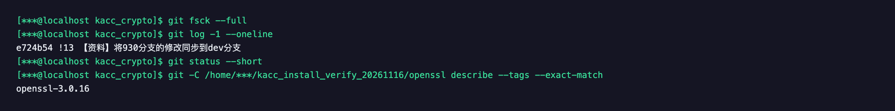

## Installing and Testing AES-XTS

### Function

The AES-XTS optimization adds an SVE2 implementation to the underlying stream layer of OpenSSL AArch64 XTS, and selects the SVE2 stream based on the platform capabilities and key size. It supports encryption and decryption for AES-128-XTS, AES-192-XTS, and AES-256-XTS.

### Integrating Optimized Code

Use the `install_sve2_xts_dispatch.sh` script to integrate the optimized code.

```bash
cd /path/to/kacc_crypto
OPENSSL_DIR=/path/to/openssl ./scripts/install_sve2_xts_dispatch.sh
```

The `install_sve2_xts_dispatch.sh` script performs the following actions.

| Step | Description |
| --- | --- |
| Copy the source code | Install `aesv8-armx-sve2.pl`, `aesv8-armx-sve2.h`, `sve2_unit_tests.c`, and `sve2_performance_test.c`. |
| Modify the build | Add `aesv8-armx-sve2.S` to `crypto/aes/build.info` for compilation. |
| Modify the capability declaration | Declare the SVE2 XTS internal interfaces and capability macros in `include/crypto/aes_platform.h`. |
| Modify the distribution | Set the SVE2 or open-source stream by key size in `cipher_aes_xts_hw.c`. |

### Compiling OpenSSL

Run the following command:

```bash
cd /path/to/openssl
perl configdata.pm -r
make -j16 > build-xts.log 2>&1
echo "AES-XTS build exit status: $?"
tail -n 4 build-xts.log
```

The integration script modifies `build.info`. Regenerate the build configuration first, and then compile. The build exit status should be `0`.


### Testing Functionality and Performance

1. Run the following command.

   ```bash
   cd /path/to/kacc_crypto
   RUN_PERF=1 OPENSSL_DIR=/path/to/openssl ./scripts/apply_and_test_xts.sh
   echo "AES-XTS tests exit status: $?"
   ```

   Functional tests should all pass with a script exit status of `0`; the performance tests should output the `native_avg`, `sve2_avg`, and `uplift` tables for AES-128/192/256-XTS encryption and decryption, with throughput in GB/s.

   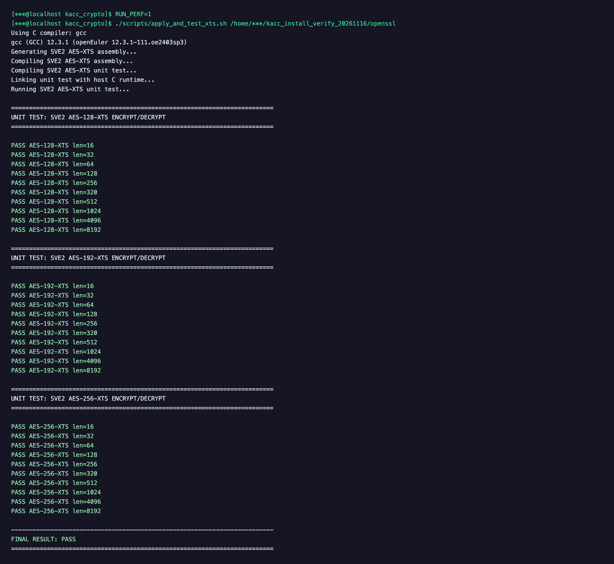

   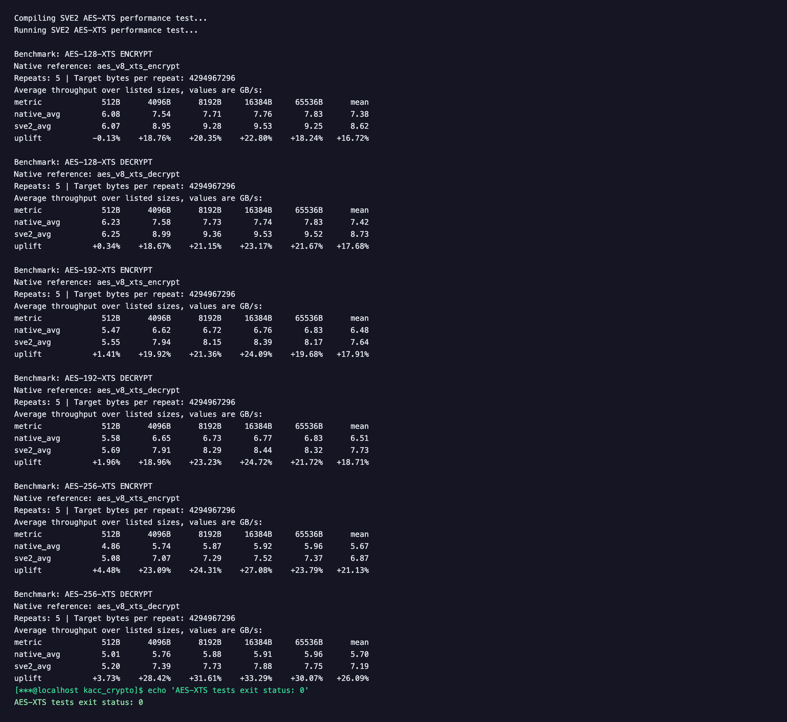

2. To run only functional tests and skip performance tests, set `RUN_PERF=0`.

   ```bash
   RUN_PERF=0 OPENSSL_DIR=/path/to/openssl ./scripts/apply_and_test_xts.sh
   ```

## Installing and Testing AES-GCM

### Function

The AES-GCM optimization adds an SVE2 path that combines AES-CTR and GHASH computations for large data blocks in OpenSSL GCM. The SVE2 path is used when the input length reaches 8,192 bytes, the platform supports AES/PMULL/SVE2, and the current context uses the Armv8 GCM assembly; the Armv8/NEON path continues to be used for small packets, tail data, and scenarios that do not meet the capability conditions.

### Integrating Optimized Code

Use the `install_sve2_gcm_dispatch.sh` script to integrate the optimized code.

```bash
cd /path/to/kacc_crypto
OPENSSL_DIR=/path/to/openssl ./scripts/install_sve2_gcm_dispatch.sh
```

The `install_sve2_gcm_dispatch.sh` script performs the following actions.

| Step | Description |
| --- | --- |
| Copy the source code | Install `gcm-sve2-armv8.c`, `ghash-sve2-armv8_64.pl`, `gcm_unit_bench.c`, and the GCM test script. |
| Modify the build | Add the SVE2 GCM C and assembly files to `crypto/modes/build.info` for compilation. |
| Modify the capability declaration | Add the GCM capability macro, threshold macro, and internal interface declaration to `include/crypto/aes_platform.h`. |
| Modify the context | Add a `pairtab` cache to `cipher_aes_gcm.h/c` and handle its copying and release. |
| Modify the distribution | Add SVE2 dispatch for input lengths of 8,192 bytes or more in `cipher_aes_gcm_hw.c`. |

### Compiling OpenSSL

```bash
cd /path/to/openssl
perl configdata.pm -r
make -j16 > build-gcm.log 2>&1
echo "AES-GCM build exit status: $?"
tail -n 4 build-gcm.log
```

The build exit status should be `0`.

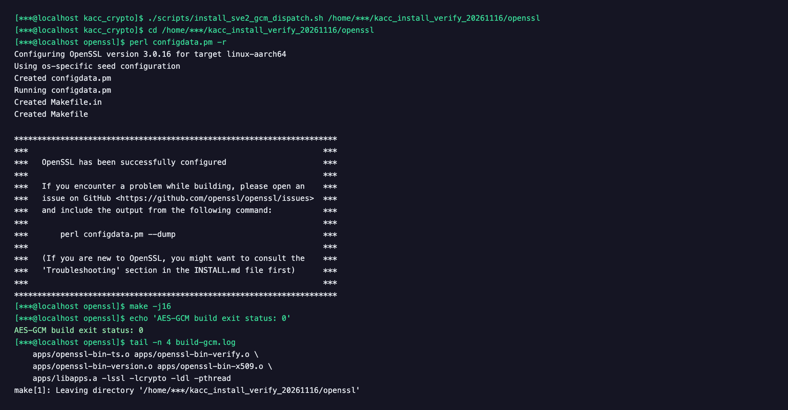

### Testing Functionality

```bash
cd /path/to/openssl/crypto/modes/asm
./run_gcm_unit_bench.sh --verify-only
echo "AES-GCM verify exit status: $?"
```

The output should include `sve2 gcm product candidate verify: PASS`, and the exit status should be `0`.

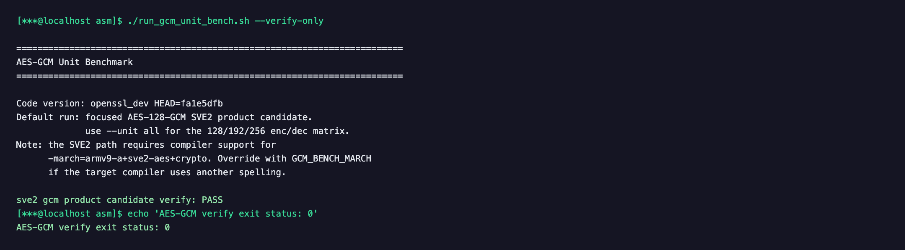

### Testing Performance

1. Run the complete performance matrix.

   ```bash
   cd /path/to/openssl/crypto/modes/asm
   ./run_all_gcm_tests.sh
   echo "AES-GCM full suite exit status: $?"
   ```

   The output should include `All AES-GCM tests passed`, and the exit status should be `0`. The performance tables list the 128/192/256-bit key encryption and decryption results for NEON and SVE2 respectively. The default sizes are 16, 64, 256, 1,024, 8,192, and 16,384 bytes, and the values are the best throughput across five test rounds, in GB/s. `mean` is the arithmetic mean of all sizes, not a weighted throughput.

   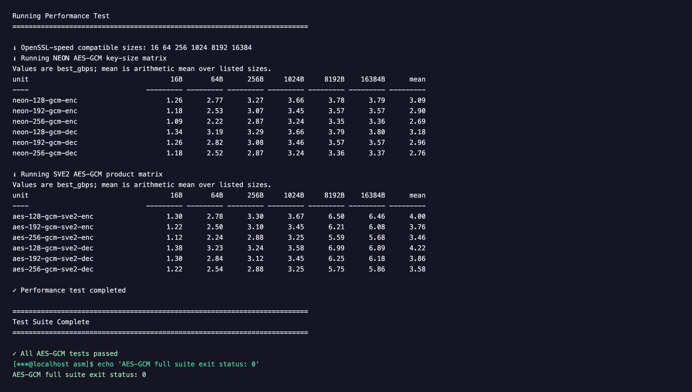

2. Specify the data sizes to test.

   ```bash
   GCM_SPEED_SIZES="16 64 256 1024 8192 16384" ./run_all_gcm_tests.sh
   ```

3. Run a specific test.

   ```bash
   ./run_gcm_unit_bench.sh --unit aes-128-gcm-sve2-enc --size 16384
   ./run_gcm_unit_bench.sh --unit aes-256-gcm-sve2-dec --size 16384
   ```

## Installing and Testing RSA

### Function

The RSA optimization uses SVE2 instructions and an 8-way multi-buffer approach to optimize the Montgomery modular exponentiation hot path in private-key CRT operations. Currently, an independent benchmark is used to verify the performance of RSA2048 and RSA4096 mathematical private-key operations. CRT recombination still uses OpenSSL BN.

### Integrating Optimized Code

Use the `install_rsa_rsaz29_x8.sh` script to integrate the optimized code.

```bash
cd /path/to/kacc_crypto
export OPENSSL_DIR=/path/to/openssl
OPENSSL_DIR=/path/to/openssl ./scripts/install_rsa_rsaz29_x8.sh
test -f "$OPENSSL_DIR/crypto/bn/asm/rsaz29-sve2-x8.S"&&test -f "$OPENSSL_DIR/test/rsa2048_private_rsaz29_x8_bench.c"&&test -f "$OPENSSL_DIR/test/rsa4096_private_rsaz29_x8_bench.c"
echo "RSA source checks exit status: $?"
```

The `install_rsa_rsaz29_x8.sh` script performs the following actions.

| Step | Description |
| --- | --- |
| Copy assembly | Install `rsaz29-sve2-x8.S` to the target OpenSSL `crypto/bn/asm`. |
| Copy tests | Install `rsa2048_private_rsaz29_x8_bench.c` and `rsa4096_private_rsaz29_x8_bench.c` to the target OpenSSL `test`. |

The integration script produces no output by default; the preceding files should exist, and the check exit status should be `0`.

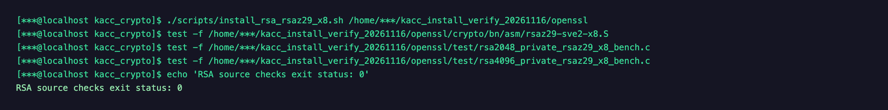

### Compiling and Running

- Compile and run the RSA2048 benchmark.

  ```bash
  cd /path/to/kacc_crypto
  RSA_BENCH_BITS=2048 RSA_BENCH_RUN=1 \
  RSA_BENCH_ITERS=1000 RSA_BENCH_MODE=all \
  OPENSSL_DIR=/path/to/openssl ./scripts/apply_and_test_rsa.sh
  echo "RSA-2048 tests exit status: $?"
  ```

  The output should include `correctness=PASS` and provide the time cost and speedup of the native and SVE2 paths. The exit status should be `0`.

  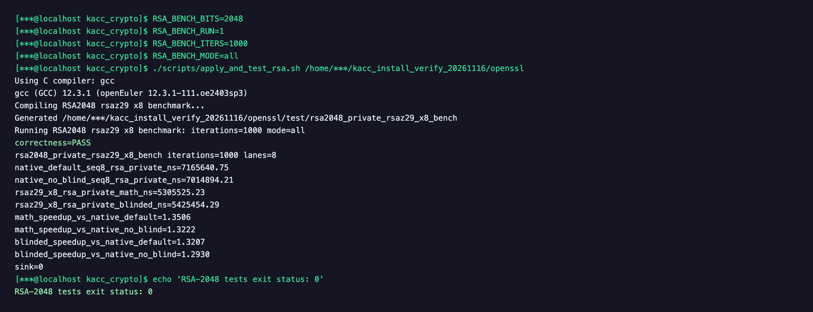

- Compile and run the RSA4096 benchmark.

  ```bash
  cd /path/to/kacc_crypto
  RSA_BENCH_BITS=4096 RSA_BENCH_RUN=1 \
  RSA_BENCH_ITERS=100 RSA_BENCH_MODE=all \
  OPENSSL_DIR=/path/to/openssl ./scripts/apply_and_test_rsa.sh
  echo "RSA-4096 tests exit status: $?"
  ```

  The output should include `correctness=PASS` and performance data, and the exit status should be `0`. Currently, the `*_ns` values in the RSA timing output are the time cost per 8-way batch, not the time cost of a single RSA request.

  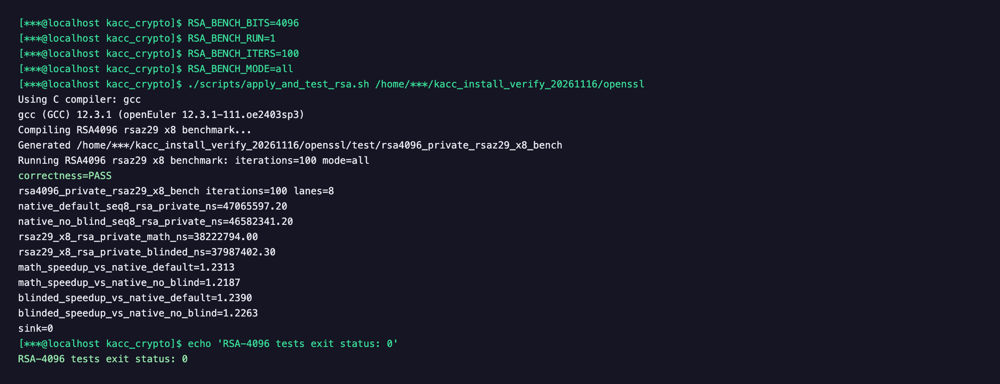

`RSA_BENCH_RUN=1` indicates compile-and-run; if it is not set, only the benchmark is generated and no test is run.

### Common Parameters

| Parameter | Description | Default Value |
| --- | --- | --- |
| RSA_BENCH_BITS | RSA key size. Options: `all`, `2048`, and `4096`. | all |
| RSA_BENCH_ITERS | Number of benchmark iterations. | 1000 |
| RSA_BENCH_RUN | `0`: compile only; `1`: compile and then run. | 0 |
| RSA_BENCH_CORE | Uses `taskset` to bind CPU cores. | Not bound |
| RSA_BENCH_MODE | Options: `all`, `native_default`, `native_no_blind`, `rsaz29_math`, and `rsaz29_blind` | all |
| RSA_BENCH_LINK | Options: `auto`, `static`, and `shared`; controls whether to link the OpenSSL static or shared library. | auto |
| OPENSSL_LIB | Explicitly specifies the path to `libcrypto.a` or `libcrypto.so`. | Not specified |
| CC | Benchmark compiler. | cc |

## Uninstalling KACC_Crypto Integration

KACC_Crypto currently does not provide an automatic uninstallation script. To restore the target OpenSSL source tree, it is recommended to rebuild from a clean OpenSSL source code, or use a version control tool in the target OpenSSL repository to revert the files and anchor modifications written by `scripts/install_*`.

## Change History

| Version | Date | Description |
| ---- | ---- | -- |
| 01 | 2026-09-30 | This is the first official release. |
