# 安装指南

## 环境部署

### 环境要求

安装前请确保环境满足KACC_Crypto当前支持范围。

**表 1** 硬件要求

| 项目 | 说明 |
| --- | --- |
| 服务器和处理器 | 鲲鹏950处理器 |
| 架构 | AArch64 |
| SVE向量长度 | AES-XTS热路径按256bit向量长度优化 |
| 加速设备 | 无外部加速卡要求 |

**表 2** 操作系统与软件要求

| 项目 | 说明 |
| --- | --- |
| 操作系统 | AArch64 Linux |
| OpenSSL | OpenSSL 3.0.16 |
| 编译器 | 支持AArch64 SVE2相关`-march`选项的GCC或Clang |
| 构建工具 | Git、GCC、make、perl、Python 3 |

>  **说明：**
>
>- AES-GCM和AES-XTS优化依赖AArch64 SVE2能力，不满足能力条件时应回到OpenSSL原本路径。
>- RSA benchmark使用SVE2汇编并链接OpenSSL的`libcrypto`库，支持`libcrypto.a`和`libcrypto.so`。
>- 未列入已验证环境的组合需要单独完成兼容性和性能验证。

### 安装依赖

- yum系发行版。

  ```bash
  sudo yum install -y git gcc make perl python3
  ```

- apt系发行版。

  ```bash
  sudo apt-get update
  sudo apt-get install -y git gcc make perl python3
  ```

## 安装方式说明

KACC_Crypto当前提供源码接入方式：仓库保存优化相关源码、接入脚本和测试脚本；使用时将优化代码接入到目标OpenSSL源码树，再重新编译OpenSSL或独立编译benchmark。

**表 3** 安装方式说明

| 安装方式 | 安装说明 | 适用场景 |
| --- | --- | --- |
| 源码接入 | 通过scripts/install_*脚本修改目标OpenSSL源码树并复制优化源码。 | 功能验证、性能验证、后续上游化开发。 |
| 一键验证 | 通过scripts/apply_and_test_*脚本完成接入和测试。 | 快速回归单个算法。 |

## 准备OpenSSL源码树

下列截图由openEuler 24.03 LTS-SP3、GCC 12.3.1环境中采集的实际命令回显脱敏后渲染，未改写测试结果，用户名及用户目录以`***`替代。截图中的验证目录仅为示例，不需要使用相同目录名。示例编译并发数为16，可按机器资源调整。

1. 获取OpenSSL源码。

    ```bash
    git clone --depth 1 -b openssl-3.0.16 https://github.com/openssl/openssl.git openssl
    cd openssl
    ```

2. 配置并编译OpenSSL。

    ```bash
    ./Configure linux-aarch64
    make -j16 > build-native.log 2>&1
    echo "OpenSSL build exit status: $?"
    tail -n 4 build-native.log
    ```

    确认编译退出码为`0`，再检查生成物和运行版本。

    ```bash
    test -f include/openssl/configuration.h
    test -f libcrypto.a || test -f libcrypto.so || test -f .openssl/lib/libcrypto.so
    echo $?
    LD_LIBRARY_PATH="$PWD" ./apps/openssl version
    ```

    检查命令的退出码应为`0`，版本应为`OpenSSL 3.0.16`。此处生成的是源码树内的库和程序，后续`OPENSSL_DIR`指向该源码树，不是系统`/usr/bin/openssl`所在目录。

    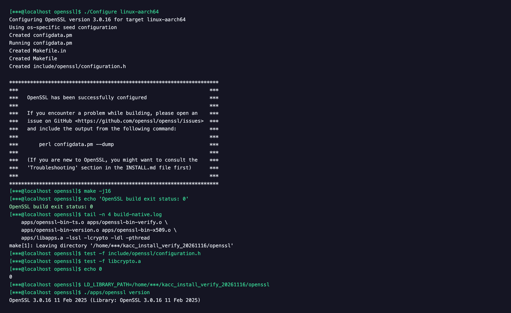

## 获取KACC_Crypto代码

```bash
git clone --depth 1 -b dev https://gitcode.com/boostkit/kacc_crypto.git kacc_crypto
cd kacc_crypto
export OPENSSL_DIR=/path/to/openssl
```

`/path/to/openssl`是实际已配置、编译完成的OpenSSL源码树路径，后续命令均替换为该路径。

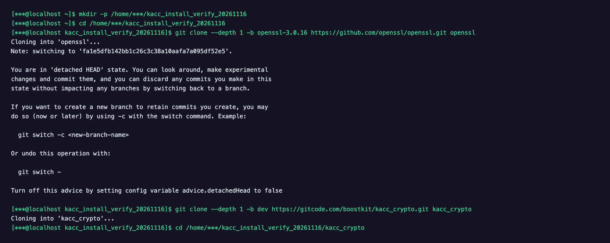

## 软件包完整性校验

本项目当前通过Git仓库提供源码，使用`git clone`获取，不提供独立的软件压缩包、数字签名文件或SHA-256校验文件。获取源码后，可检查Git对象完整性、源码提交版本及工作区状态。

```bash
git fsck --full
git log -1 --oneline
git status --short
```

`git fsck --full`应成功退出；刚克隆的工作区执行`git status --short`应无输出。

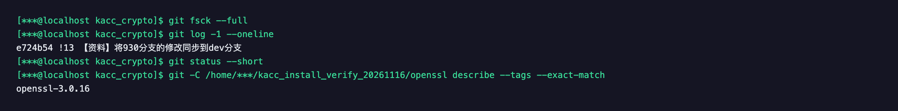

## 安装与测试AES-XTS

### 功能说明

AES-XTS优化在OpenSSL AArch64 XTS底层stream层新增SVE2实现，并根据平台能力和key size选择SVE2 stream。支持AES-128-XTS、AES-192-XTS、AES-256-XTS的加密和解密。

### 接入优化代码

使用`install_sve2_xts_dispatch.sh`脚本接入优化代码。

```bash
cd /path/to/kacc_crypto
OPENSSL_DIR=/path/to/openssl ./scripts/install_sve2_xts_dispatch.sh
```

`install_sve2_xts_dispatch.sh`脚本会执行以下动作。

| 步骤 | 修改内容 |
| --- | --- |
| 拷贝源码 | 安装aesv8-armx-sve2.pl、aesv8-armx-sve2.h、sve2_unit_tests.c、sve2_performance_test.c。 |
| 修改构建 | 在crypto/aes/build.info中加入aesv8-armx-sve2.S生成和编译目标。 |
| 修改能力声明 | 在include/crypto/aes_platform.h中声明SVE2 XTS内部接口和能力宏。 |
| 修改分发 | 在cipher_aes_xts_hw.c中按key size设置SVE2或开源stream。 |

### 编译OpenSSL

执行以下命令。

```bash
cd /path/to/openssl
perl configdata.pm -r
make -j16 > build-xts.log 2>&1
echo "AES-XTS build exit status: $?"
tail -n 4 build-xts.log
```

接入脚本修改了`build.info`，先重新生成构建配置，再编译。编译退出码应为`0`。


### 测试功能和性能

1. 执行以下命令。

   ```bash
   cd /path/to/kacc_crypto
   RUN_PERF=1 OPENSSL_DIR=/path/to/openssl ./scripts/apply_and_test_xts.sh
   echo "AES-XTS tests exit status: $?"
   ```

   功能测试应全部通过，脚本退出码为`0`；性能测试应输出AES-128/192/256-XTS加密和解密的`native_avg`、`sve2_avg`及`uplift`表格，吞吐单位为GB/s。

   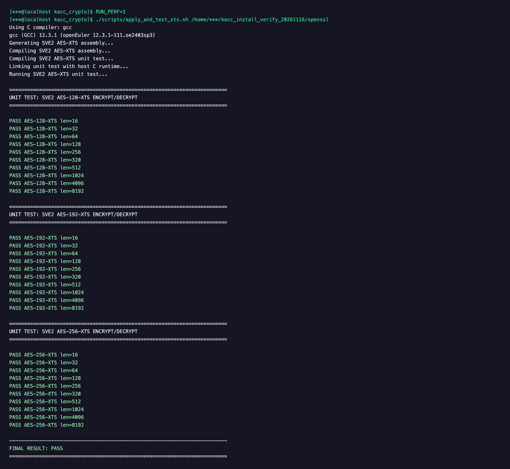

   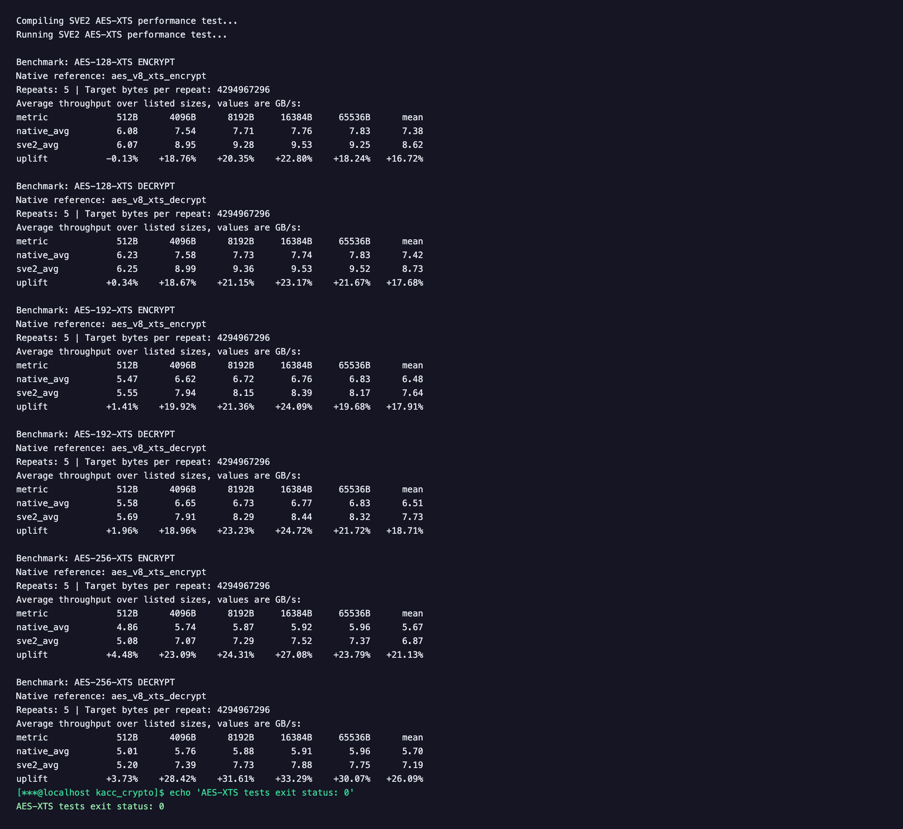

2. 如需仅运行功能测试、不运行性能测试，设置`RUN_PERF=0`。

   ```bash
   RUN_PERF=0 OPENSSL_DIR=/path/to/openssl ./scripts/apply_and_test_xts.sh
   ```

## 安装与测试AES-GCM

### 功能说明

AES-GCM优化在OpenSSL GCM大块路径中增加SVE2 AES-CTR与GHASH融合计算路径。输入长度达到8192Byte、平台支持AES/PMULL/SVE2且当前上下文使用ARMv8 GCM汇编时进入SVE2；小包、尾部和不满足能力条件的场景继续使用ARMv8/NEON路径。

### 接入优化代码

使用`install_sve2_gcm_dispatch.sh`脚本接入优化代码。

```bash
cd /path/to/kacc_crypto
OPENSSL_DIR=/path/to/openssl ./scripts/install_sve2_gcm_dispatch.sh
```

`install_sve2_gcm_dispatch.sh`脚本会执行以下动作。

| 步骤 | 修改内容 |
| --- | --- |
| 拷贝源码 | 安装gcm-sve2-armv8.c、ghash-sve2-armv8_64.pl、gcm_unit_bench.c和GCM测试脚本。 |
| 修改构建 | 在crypto/modes/build.info中加入SVE2 GCM C文件和汇编生成目标。 |
| 修改能力声明 | 在include/crypto/aes_platform.h中增加GCM能力宏、阈值宏和内部接口声明。 |
| 修改上下文 | 在cipher_aes_gcm.h/c中增加pairtab缓存并处理复制和释放。 |
| 修改分发 | 在cipher_aes_gcm_hw.c中插入8192B大窗口SVE2分发。 |

### 编译OpenSSL

```bash
cd /path/to/openssl
perl configdata.pm -r
make -j16 > build-gcm.log 2>&1
echo "AES-GCM build exit status: $?"
tail -n 4 build-gcm.log
```

编译退出码应为`0`。

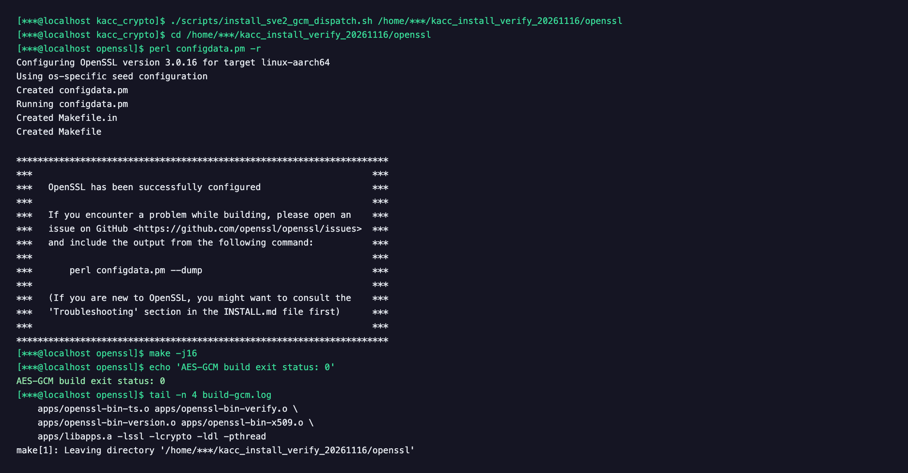

### 功能测试

```bash
cd /path/to/openssl/crypto/modes/asm
./run_gcm_unit_bench.sh --verify-only
echo "AES-GCM verify exit status: $?"
```

输出应包含`sve2 gcm product candidate verify: PASS`，退出码应为`0`。

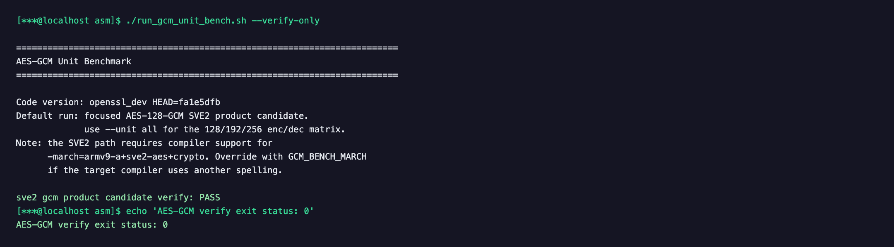

### 性能测试

1. 执行完整性能矩阵。

   ```bash
   cd /path/to/openssl/crypto/modes/asm
   ./run_all_gcm_tests.sh
   echo "AES-GCM full suite exit status: $?"
   ```

   输出应包含`All AES-GCM tests passed`，退出码应为`0`。性能表分别列出NEON和SVE2的128/192/256位密钥加解密结果，默认尺寸为16、64、256、1024、8192和16384Byte，数值为5轮测试中的最佳吞吐，单位为GB/s；`mean`为各尺寸的算术平均值，不是加权吞吐。

   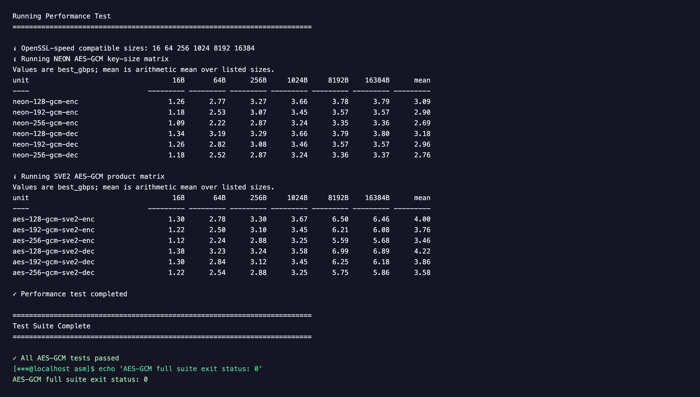

2. 指定长度规格。

   ```bash
   GCM_SPEED_SIZES="16 64 256 1024 8192 16384" ./run_all_gcm_tests.sh
   ```

3. 指定单项。

   ```bash
   ./run_gcm_unit_bench.sh --unit aes-128-gcm-sve2-enc --size 16384
   ./run_gcm_unit_bench.sh --unit aes-256-gcm-sve2-dec --size 16384
   ```

## 安装与测试RSA

### 功能说明

RSA优化使用SVE2指令和8路多缓冲方式优化private CRT中的Montgomery模幂热点。当前通过独立benchmark验证RSA2048和RSA4096的数学私钥运算性能，CRT recombine仍使用OpenSSL BN。

### 接入优化代码

使用`install_rsa_rsaz29_x8.sh`脚本接入优化代码。

```bash
cd /path/to/kacc_crypto
OPENSSL_DIR=/path/to/openssl ./scripts/install_rsa_rsaz29_x8.sh
test -f "$OPENSSL_DIR/crypto/bn/asm/rsaz29-sve2-x8.S"
test -f "$OPENSSL_DIR/test/rsa2048_private_rsaz29_x8_bench.c"
test -f "$OPENSSL_DIR/test/rsa4096_private_rsaz29_x8_bench.c"
echo "RSA source checks exit status: $?"
```

`install_rsa_rsaz29_x8.sh`脚本会执行以下动作。

| 步骤 | 修改内容 |
| --- | --- |
| 拷贝汇编 | 安装rsaz29-sve2-x8.S到目标OpenSSL crypto/bn/asm。 |
| 拷贝测试 | 安装rsa2048_private_rsaz29_x8_bench.c和rsa4096_private_rsaz29_x8_bench.c到目标OpenSSL test。 |

接入脚本默认无回显；上述文件应存在，检查退出码应为`0`。

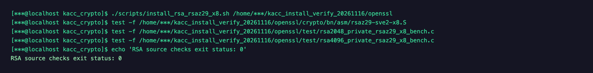

### 编译并运行

- 编译并运行RSA2048 benchmark。

  ```bash
  cd /path/to/kacc_crypto
  RSA_BENCH_BITS=2048 RSA_BENCH_RUN=1 \
  RSA_BENCH_ITERS=1000 RSA_BENCH_MODE=all \
  OPENSSL_DIR=/path/to/openssl ./scripts/apply_and_test_rsa.sh
  echo "RSA-2048 tests exit status: $?"
  ```

  输出应包含`correctness=PASS`，并给出native及SVE2路径的耗时和加速比，退出码应为`0`。

  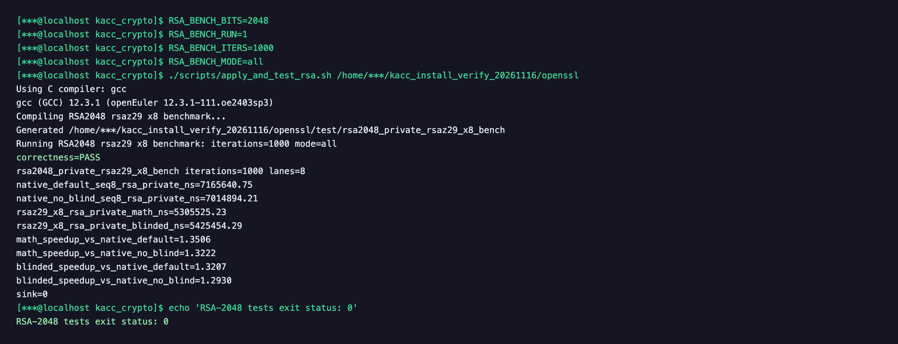

- 编译并运行RSA4096 benchmark。

  ```bash
  cd /path/to/kacc_crypto
  RSA_BENCH_BITS=4096 RSA_BENCH_RUN=1 \
  RSA_BENCH_ITERS=100 RSA_BENCH_MODE=all \
  OPENSSL_DIR=/path/to/openssl ./scripts/apply_and_test_rsa.sh
  echo "RSA-4096 tests exit status: $?"
  ```

  输出应包含`correctness=PASS`，并给出性能数据，退出码应为`0`。当前RSA计时输出的`*_ns`为每次8路批处理的耗时，不是单条RSA请求的耗时。

  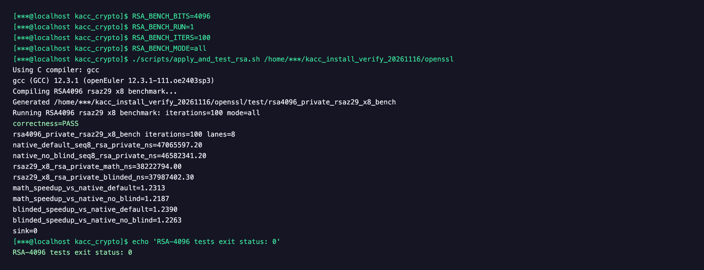

`RSA_BENCH_RUN=1`表示编译后执行；不设置时仅生成benchmark，不运行测试。

### 常用参数

| 参数 | 说明 | 默认值 |
| --- | --- | --- |
| RSA_BENCH_BITS | RSA key size，支持all、2048和4096 | all |
| RSA_BENCH_ITERS | benchmark迭代次数 | 1000 |
| RSA_BENCH_RUN | 0仅编译，1编译后运行 | 0 |
| RSA_BENCH_CORE | 使用taskset绑定CPU core | 未绑定 |
| RSA_BENCH_MODE | all、native_default、native_no_blind、rsaz29_math、rsaz29_blind | all |
| RSA_BENCH_LINK | auto、static、shared，控制链接OpenSSL静态库或动态库 | auto |
| OPENSSL_LIB | 显式指定libcrypto.a或libcrypto.so路径 | 未指定 |
| CC | benchmark编译器 | cc |

## 卸载KACC_Crypto接入内容

KACC_Crypto当前不提供自动卸载脚本。如需恢复目标OpenSSL源码树，建议使用干净OpenSSL源码重新构建，或在目标OpenSSL仓库中通过版本控制工具回退由`scripts/install_*`写入的文件和锚点修改。

## 修订记录

| 文档版本 | 发布日期 | 修改说明 |
| ---- | ---- | -- |
| 01 | 2026-09-30 | 第一次正式发布。 |
